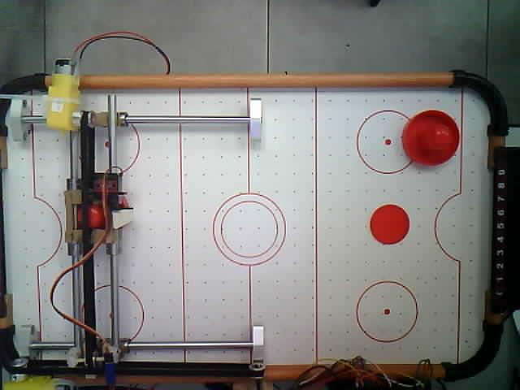
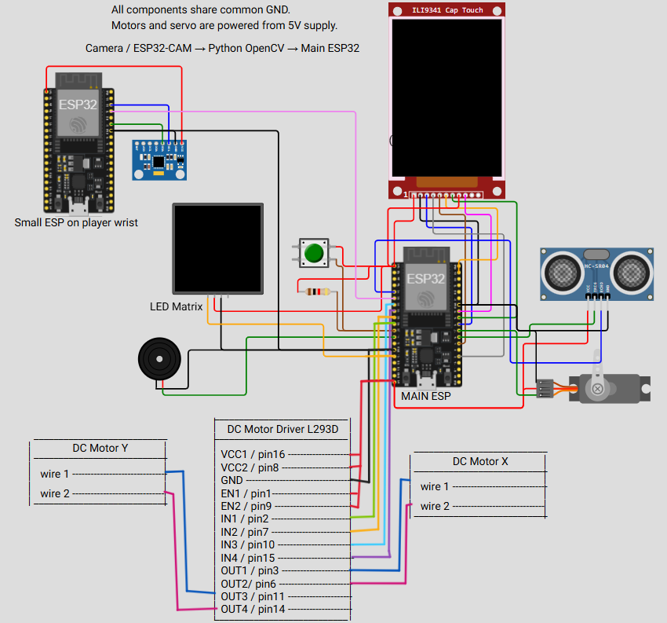

# Air Hockey Robot

An air hockey table with an autonomous robot opponent. A main ESP32 drives the robot (X/Y DC motors and a striking servo), an ESP32-CAM tracks the puck, a Python server detects the puck position, a wearable ESP-NOW bracelet confirms the player is ready, and a React website manages bookings, subscriptions and live games.



## Repository structure

| Folder | Description |
|---|---|
| `Arduino/AirHockeyMain` | Main ESP32 firmware: motors, servo, IR goal sensors, LCD touch menu, LED matrix, speaker, Firebase, REST API for the website |
| `CameraWebServer` | ESP32-CAM firmware that serves camera frames |
| `small_ESP` | Bracelet firmware (touch sensor + ESP-NOW) |
| `Python_Live_Pair_Detector` | FastAPI server that detects the puck in camera frames and sends targets to the main ESP32 |
| `ReactProject` | Management website (React + Tailwind) |
| `docs` | Project book, images and development notes |

## System overview

1. The ESP32-CAM captures frames of the table.
2. The Python server detects the puck and sends its position to the main ESP32.
3. The main ESP32 calculates the puck speed and acceleration and moves the robot to intercept it.
4. When the puck is in reach, the servo strikes it toward the center of the table.
5. IR sensors in both goals count the score, which is shown on the LCD and the website.
6. The player must wear the bracelet during the whole game. If touch is lost, the motors stop and the game pauses.

## Configuration

Passwords and keys were removed from the code. Fill them in before uploading to the boards:

- `Arduino/AirHockeyMain/Global.h`: `WIFI_SSID`, `WIFI_PASSWORD`, `API_KEY`, `FIREBASE_PROJECT_ID`, `USER_EMAIL`, `USER_PASSWORD`, `PYTHON_SERVER_IP`
- `CameraWebServer/CameraWebServer.ino`: `ssid`, `password`
- `Python_Live_Pair_Detector/main_pair_live.py`: `CAMERA_IP`, `MAIN_ESP_IP`
- `ReactProject/src/api/esp32.js`: `ESP32_IP`

## Main ESP32 wiring



| Part | Pin |
|---|---|
| Motor X: IN1 / IN2 / PWM | GPIO 26 / 25 / 33 |
| Motor Y: IN3 / IN4 / PWM | GPIO 32 / 21 / 22 |
| Servo signal | GPIO 13 |
| IR sensor, robot goal | GPIO 27 |
| IR sensor, player goal | GPIO 34 |
| Distance sensor Trig / Echo | GPIO 16 / 35 |

PWM channels: motor X = 4, motor Y = 5, speaker = 6, channels 0-3 are reserved for the servo.

Directions: X +1 = right, X -1 = left, Y +1 = forward (larger Y), Y -1 = backward.

The IR goal sensors are active LOW (1 = no puck, 0 = puck detected) and use FALLING interrupts so short passes are not missed.

If the distance sensor is an HC-SR04 powered from 5V, its Echo output can be 5V. Do not connect it directly to GPIO 35; use a voltage divider.

## Running

**Arduino (main ESP32)**

Open `Arduino/AirHockeyMain/AirHockeyMain.ino`, select `ESP32 Dev Module`, and upload the whole folder.

**Bracelet**

Upload `small_ESP/small_ESP.ino` to the small ESP32. Start the main ESP32 first, then the bracelet. See [docs/notes/bracelet-espnow.md](docs/notes/bracelet-espnow.md).

**Python server**

```
cd Python_Live_Pair_Detector
py -m pip install -r requirements.txt
run_live_pair_server.bat
```

Status page: `http://127.0.0.1:8001/camera/status`. More details in [Python_Live_Pair_Detector/README.md](Python_Live_Pair_Detector/README.md).

**React website**

```
cd ReactProject
npm install
npm start
```

## Manual tests

- Robot status: `http://<main-esp-ip>/robot-status`
- Move to a far point: `http://<main-esp-ip>/move?x=11&y=13`
- Move back to a near point: `http://<main-esp-ip>/move?x=2&y=3`
- Servo at the same X/Y: send the same request again. The DC motors do not move, but the servo still strikes.

## Known limitations

There are no encoders or home sensors. `currentX` / `currentY` are estimated from motor run time, so the mechanism must start at `START_X_CM` / `START_Y_CM`, and `CM_TO_TIME_MS_X` / `CM_TO_TIME_MS_Y` need calibration on the real table.

## Development notes

The `docs/notes` folder describes the changes in each version:

- [Version 2](docs/notes/v2.md)
- [Version 3 – center strike](docs/notes/v3-center-strike.md)
- [IR pins and server update](docs/notes/ir-pins-and-server.md)
- [Fast response](docs/notes/fast-response.md)
- [ESP-NOW bracelet](docs/notes/bracelet-espnow.md)
